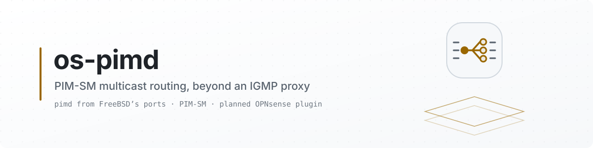

<picture>
  <source media="(prefers-color-scheme: dark)" srcset="docs/images/readme/banner-dark.svg">
  <source media="(prefers-color-scheme: light)" srcset="docs/images/readme/banner-light.svg">
  
</picture>

  
  
  
  

# PIM-SM Multicast Routing for OPNsense

A page for pimd, the PIM-SM multicast router in FreeBSD's ports, for networks that need multicast routing beyond an IGMP proxy.

> **Planned - nothing here runs yet.** This repository was opened on 2026-11-16 to hold
> PIM-SM Multicast Routing as a plugin of its own. No code has been written or moved into it, and there is no
> release.

## What it is to do

- pimd set from a page: interfaces, rendezvous point, thresholds;
- its neighbours and routes shown;
- the service run and watched like the other services of OPNsense.

## Where it fits

It is one part of the [os-xgs-npu](https://github.com/AbdelmonemAwad/os-xgs-npu) project, which puts OPNsense on Sophos XGS hardware, and works the way its other plugins do: changes by pull request, a release installed from **XGS: Updates**, its Arabic in [opnsense-arabic](https://github.com/AbdelmonemAwad/opnsense-arabic)'s catalogue.

## Licence

BSD 2-Clause - see [LICENSE](LICENSE).
